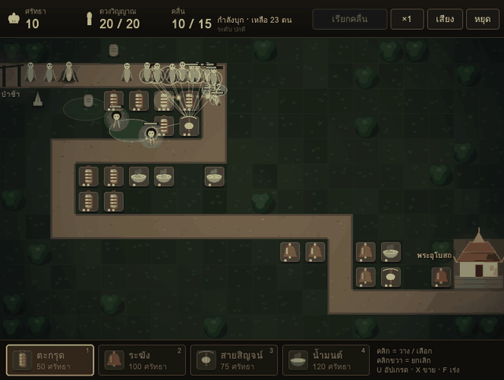
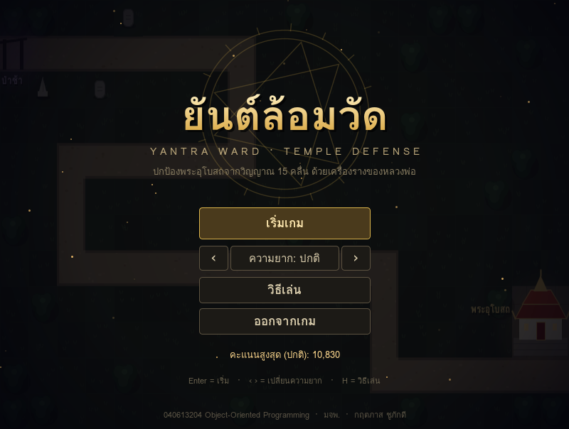
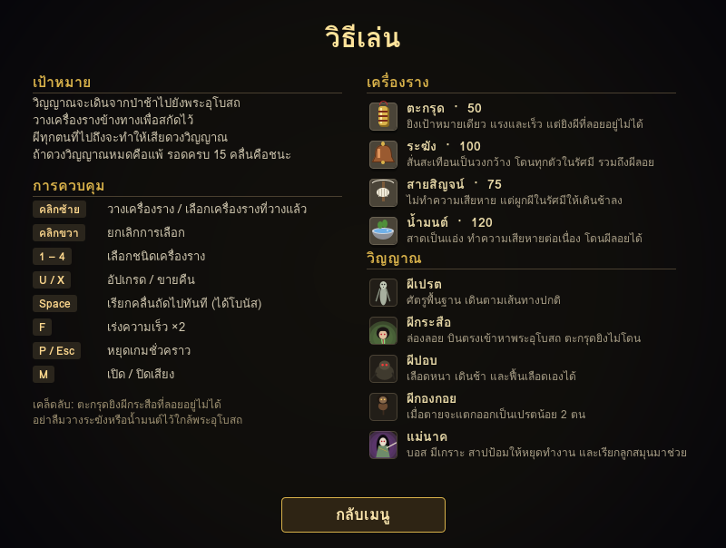
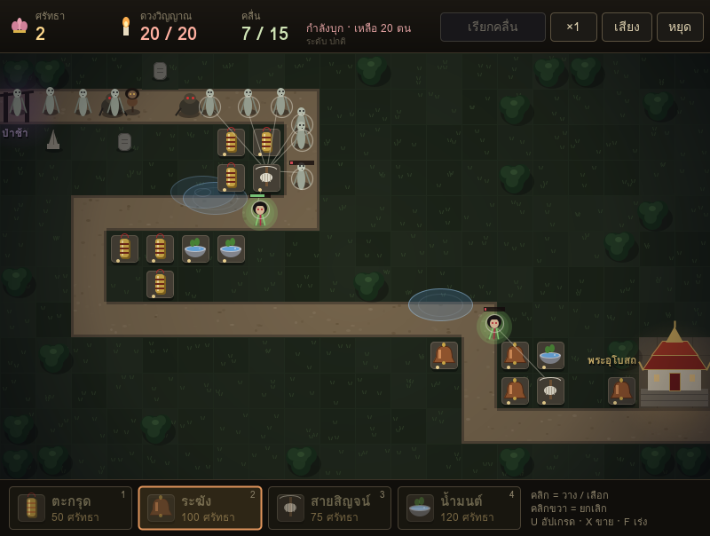
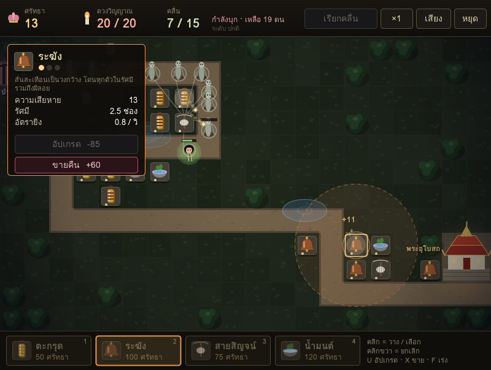
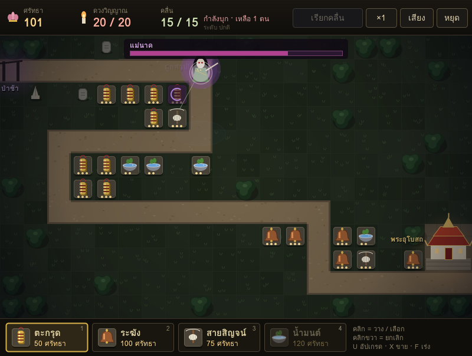
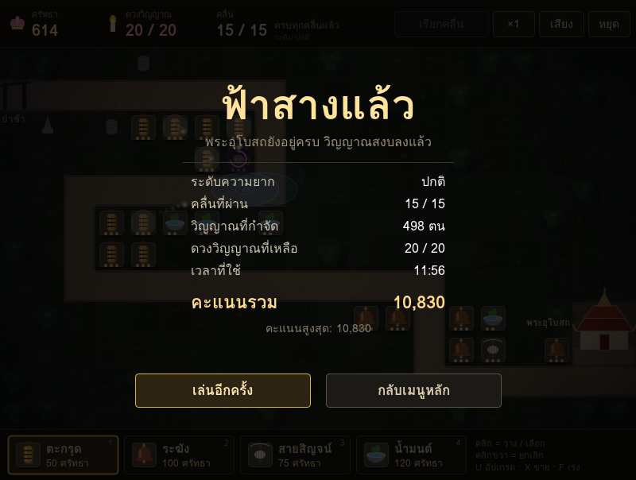
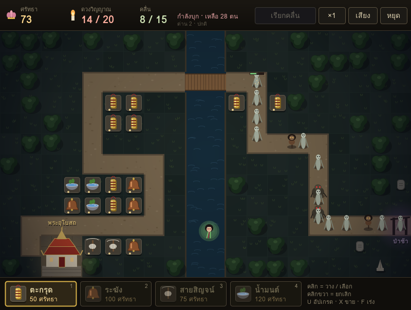
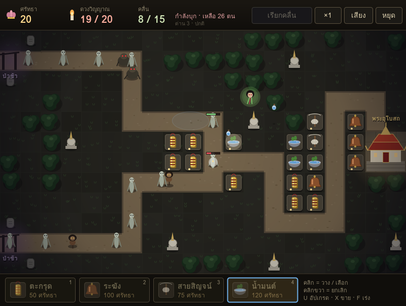

# ยันต์ล้อมวัด — Yantra Ward : Temple Defense

เกม Tower Defense ธีมผีไทย · วิชา 040613204 Object-Oriented Programming · มจพ.
เขียนด้วย **Java + Swing ล้วน** ไม่ใช้ Game Engine ไม่มีไลบรารีภายนอก ไม่มีไฟล์รูป/เสียง (วาดภาพ สังเคราะห์เสียงเอฟเฟกต์ และแต่งเพลงประกอบแนวระนาดด้วยโค้ดทั้งหมด)



---

## วิธีเปิดใน NetBeans

1. `File → Open Project...` แล้วเลือกโฟลเดอร์ `YantraWard` (จะเห็นเป็นไอคอนโปรเจกต์ Maven)
2. กด **Run Project** (F6)
3. ครั้งแรก NetBeans จะดาวน์โหลด plugin ของ Maven ให้อัตโนมัติ (ต้องต่อเน็ต) ครั้งต่อไปไม่ต้อง

ถ้า NetBeans ถาม Main Class ให้เลือก `yantra.Main`

## เล่นทันทีโดยไม่เปิด NetBeans

ดับเบิลคลิก `run.bat` (Java 8 ขึ้นไปก็เล่นได้ แต่แนะนำ Java 17+ ภาพจะคมบนจอที่ตั้ง scale 125–150%; run.bat จะหา Java รุ่นใหม่ในเครื่องให้อัตโนมัติ) — ใช้ `YantraWard.jar` ที่ build ไว้แล้ว

---

## วิธีเล่น

| ปุ่ม | ความหมาย |
|---|---|
| คลิกซ้าย | วางเครื่องราง / เลือกเครื่องรางที่วางแล้ว |
| คลิกขวา | ยกเลิกการเลือก |
| `1` – `4` | เลือกชนิดเครื่องราง (กดซ้ำ = ดูรายละเอียด) |
| `U` / `X` | อัปเกรด / ขายคืน |
| `Space` | เรียกคลื่นถัดไปทันที (ได้โบนัสศรัทธา) |
| `F` | เร่งความเร็ว ×2 / ×4 (กดวน) |
| `P` / `Esc` | หยุดชั่วคราว |
| `M` | เปิด / ปิดเสียง |
| `S` (หน้าเมนู) | ตั้งค่าเสียง — ปรับเสียงรวม / เพลงประกอบ / เสียงเอฟเฟกต์ (เปิดจากเมนูหยุดเกมได้ด้วย) |

รอดครบ 15 คลื่น = ชนะ · คลื่นสุดท้ายมีบอส **แม่นาค** · ชนะแล้วกด **ด่านถัดไป** ได้เลย

| ด่าน | ชื่อ | จุดเด่น |
|---|---|---|
| 1 | วัดร้างกลางป่า | ทางเดียวคดเคี้ยว เหมาะเริ่มต้น |
| 2 | ท่าน้ำริมคลอง | มีคลองกั้นกลาง วางป้อมบนน้ำไม่ได้ ผีกระสือบินลัดข้ามน้ำ |
| 3 | ลานเจดีย์สองป่าช้า | ผีมาจาก **2 จุดเกิด** สลับกัน แล้วมารวมกันกลางลาน |

เลือกด่านที่หน้าเมนู (ปุ่ม ‹ › หรือลูกศรบน/ล่าง) · คะแนนสูงสุดแยกตามด่านและระดับความยาก

| ความยาก | ศรัทธาเริ่มต้น | ดวงวิญญาณ | สร้างชนิดเดิมซ้ำ | คะแนน |
|---|---|---|---|---|
| ง่าย | 450 | 30 | ราคาเท่าเดิม | ×0.8 |
| ปกติ | 320 | 20 | แพงขึ้น 6% ต่อตัว | ×1.0 |
| ยาก | 300 | 10 | แพงขึ้น 12% ต่อตัว | ×1.6 |
| **ฝันร้าย** | 400 | **1 — ผีเข้าวัดตนเดียวก็แพ้** | แพงขึ้น 15% ต่อตัว | ×2.5 |

**ราคาเพิ่มตามจำนวน:** ยิ่งมีเครื่องรางชนิดเดียวกันมาก ตัวต่อไปยิ่งแพง (ราคาในร้านจะเป็นสีส้ม) แต่ค่าอัปเกรดไม่เพิ่ม — สร้างเต็มสนามไม่คุ้มเท่าอัปเกรดตัวที่วางดี ๆ

ค่าหัวผีลดลง 2.5% ทุกคลื่น (กันเงินล้นมือช่วงท้ายเกม) · ทุกคลื่นผีจะ**เดินเร็วขึ้น 3%** (คลื่นที่ 15 เร็วกว่าคลื่นแรก 42%) — ดูได้ที่แถบบนและป้ายประกาศคลื่น
ระดับยากและฝันร้าย เลือดผีจะเพิ่มขึ้นต่อคลื่นเร็วกว่าปกติ (`Difficulty.waveGrowth`) คลื่นท้าย ๆ จึงโหดขึ้นมาก

**ยาก/ฝันร้าย จูนให้ "บอทเก่งสุดชนะแบบเฉียดฉิว":** ใช้ Genetic Algorithm (บอทที่สั่งได้แค่ปุ่มเดียวกับผู้เล่น และกด `Space` เรียกคลื่นก่อนเวลาทุกครั้ง) หาค่าเลือดผีสูงสุดที่ยังชนะได้ แล้วตั้งไว้ตรงนั้นแยกรายด่าน (`Difficulty.getHpScale(Level)`) — เพิ่มอีก 4% บอทก็แพ้

| ด่าน | ยาก: ตัวจูนเลือด | ผลบอท | ฝันร้าย: ตัวจูนเลือด | ผลบอท |
|---|---|---|---|---|
| 1 | 1.16 | ชนะ เหลือ 2/10 ดวง | 1.32 | ชนะ |
| 2 | 1.32 | ชนะ เหลือ 1/10 ดวง | 1.52 | ชนะ |
| 3 | 1.04 | ชนะ เหลือ 1/10 ดวง | 1.08 | ชนะ |

เคล็ดลับ: ระดับนี้**ต้องกด Space เรียกคลื่นก่อนเวลาทุกคลื่น** (ได้ศรัทธาเพิ่มรวมราว 200+) ไม่งั้นเงินไม่พอ

**ดูรายละเอียดเครื่องรางก่อนซื้อ:** คลิกช่องเครื่องรางด้านล่างซ้ำอีกครั้ง (หรือกดเลขเดิมซ้ำ) จะมีแผงบอกความสามารถขึ้นมุมบนซ้าย

| เครื่องราง | ราคา | ความสามารถ |
|---|---|---|
| ตะกรุด | 50 | ยิงเป้าเดียว แรงและเร็ว (ยิงผีลอยไม่ได้) |
| ระฆัง | 150 | ความเสียหายวงกว้าง ตีได้พร้อมกันสูงสุด 5 / 7 / 9 ตน (ตามระดับ) โดนผีลอย |
| สายสิญจน์ | 75 | ทำให้ผีในรัศมีเดินช้า |
| น้ำมนต์ | 140 | สาดเป็นแอ่ง ความเสียหายต่อเนื่อง โดนผีลอย |

| วิญญาณ | พฤติกรรม |
|---|---|
| ผีเปรต | เดินตามเส้นทางปกติ |
| ผีกระสือ | **บินตรง** เข้าพระอุโบสถ ไม่สนเส้นทาง |
| ผีปอบ | เลือดหนา **ฟื้นเลือดเอง** |
| ผีกองกอย | ตายแล้ว **แตกร่าง** เป็นเปรตน้อย 2 ตน |
| แม่นาค (บอส) | มีเกราะ **สาปป้อม** ให้หยุดทำงาน เรียกลูกสมุน 2 รอบ และ**คลั่ง**เมื่อเลือดต่ำกว่า 30% (เร็วขึ้น 50%) |

---

## โครงสร้างโปรเจกต์

```
src/main/java/yantra/
├── Main.java
├── core/     Setting, Game (JFrame), GamePanel (JPanel), GameLoop (Thread),
│             GameManager, Battlefield (interface)
├── screen/   Screen (abstract) → TitleScreen, HowToScreen, PlayScreen, SettingsScreen
├── entity/   Entity (abstract)
│             ├── Tower (abstract) → TalismanTower, BellTower, ThreadTower, HolyWaterTower
│             ├── Enemy (abstract) → PretEnemy, KrasueEnemy, PopEnemy, KongkoiEnemy, NakBoss
│             ├── Projectile → FlaskProjectile
│             └── TowerType, EnemyType (enum factory)
├── effect/   Effect (abstract) → Particle, FloatingText, RingEffect
│             AreaEffect (abstract) → HolyWaterPool
├── system/   GameMap, Pathfinder (BFS), WaveManager, EconomySystem, SoundManager,
│             PropertiesFile (abstract) → ScoreStore, SettingsStore
├── ui/       HUD, Button, Slider, Fonts, FieldRenderer
└── util/     Vec2<T>, Renderable, Damageable, Upgradable,
              Level, Difficulty, GameState, Sfx, InsufficientFaithException
src/main/resources/maps/level1-3.txt   แผนที่แต่ละด่าน
```

### เพิ่มด่านใหม่เอง

1. สร้างไฟล์ `src/main/resources/maps/level4.txt` ขนาด 20 × 12 ตัวอักษร
2. เพิ่มค่าใหม่ใน `enum Level` อีก 1 บรรทัด — ไม่ต้องแก้ไฟล์อื่นเลย (เส้นทางหาเองด้วย BFS)

| ตัวอักษร | ความหมาย | ตัวอักษร | ความหมาย |
|---|---|---|---|
| `.` | พื้น (วางป้อมได้) | `#` | ทางเดิน |
| `S` | ป่าช้า/จุดเกิด (มีหลายจุดได้) | `E` | พระอุโบสถ (จุดหมาย) |
| `=` | สะพาน | `~` | น้ำ |
| `W` | เขตวัด 2×2 (วาดรูปพระอุโบสถ) | `T` `G` `C` | ต้นไม้ / หลุมศพ / เจดีย์ |

## แนวคิด OOP อยู่ตรงไหน

| แนวคิด | ตัวอย่างในโค้ด |
|---|---|
| **Abstraction** | `Entity`, `Tower`, `Enemy`, `Screen`, `Effect`, `AreaEffect` เป็น abstract class |
| **Inheritance** | ป้อม 4 ชนิดสืบทอด `Tower` · ผี 5 ชนิดสืบทอด `Enemy` · 4 หน้าจอสืบทอด `Screen` · `ScoreStore` และ `SettingsStore` สืบทอดการอ่าน-เขียนไฟล์จาก `PropertiesFile` |
| **Polymorphism** | `KrasueEnemy.move()` บินตรง · `PopEnemy.update()` ฟื้นเลือด · `KongkoiEnemy.onDeath()` แตกร่าง · `NakBoss.interact()` สาปป้อม — แต่ `GameManager` เรียกเหมือนกันหมดผ่าน `Enemy` · `HolyWaterTower` เล็งดักหน้าด้วย `enemy.predictPosition()` ซึ่งผีกระสือโอเวอร์ไรด์ให้ทำนายเป็นเส้นตรง |
| **Encapsulation** | `EconomySystem` — ยอดศรัทธาเป็น private ลดได้ผ่าน `spend()` ที่ตรวจสอบก่อนเท่านั้น |
| **Interface** | `Upgradable` (มี `default` method), `Damageable`, `Renderable`, `Battlefield` |
| **Composition** | `GameManager` ประกอบจาก `GameMap` + `EconomySystem` + `WaveManager` + `SoundManager` |
| **Template Method** | `Entity.tick()`, `Enemy.render()` → `renderBody()`, `Tower.upgrade()` → `applyUpgrade()` |
| **Dependency Inversion** | ป้อม/ผีรู้จักแค่ interface `Battlefield` ไม่รู้จัก `GameManager` ตัวจริง |
| **Enum** | `TowerType` / `EnemyType` ที่แต่ละค่ามี method `create()` ของตัวเอง · `Level` และ `Difficulty` มี field + constructor |
| **Generics** | `Vec2<T extends Number>` ใช้ได้ทั้งพิกัดช่องและพิกัดพิกเซล |
| **Overloading** | `Entity.distanceTo(x,y)` / `distanceTo(Entity)` · constructor ของ `Difficulty` (มี/ไม่มีตัวจูนรายด่าน) · `getHpScale()` / `getHpScale(Level)` · `PretEnemy(path,s)` / `PretEnemy(path,s,small)` · `WaveManager.enqueue(...)` |
| **Custom Exception** | `InsufficientFaithException` โยนเมื่อศรัทธาไม่พอ |
| **Thread** | `GameLoop implements Runnable` แยกเธรดคำนวณจากเธรดวาดภาพ + `synchronized` กันชนกัน |
| **Event Handling** | `GamePanel implements MouseListener, MouseMotionListener, KeyListener` |
| **File I/O** | `GameMap` อ่านแผนที่จาก resources · `ScoreStore` บันทึกคะแนนสูงสุดลง `highscore.txt` · `SettingsStore` จำค่าเสียงไว้ใน `settings.txt` |

---

## ภาพหน้าจอ

| | |
|---|---|
|  |  |
|  |  |
|  |  |
|  |  |
